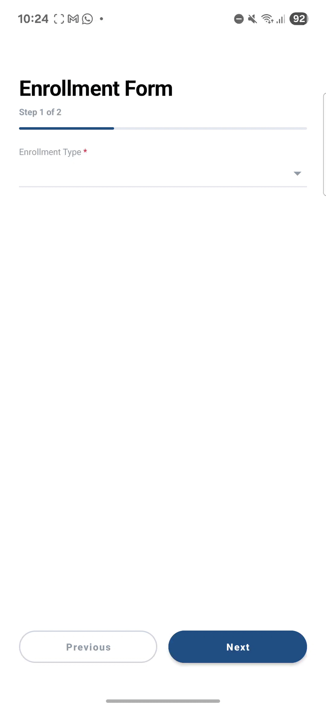

# Dynamic Form Assignment

Android application that renders a dynamic multi-step form fetched from an API. Built with Kotlin, XML layouts, and MVVM architecture.

## APK Download

Download and install the pre-built APK:
- [Download app-debug.apk](apk/app-debug.apk)

## Demo

<p align="center">
  
</p>

## Overview

The app fetches form configuration from an API endpoint and renders the inputs dynamically:

- **Pagination**: Splits fields across multiple pages using `separator` field types.
- **Field Types**: Supports dropdown selection (`enrollment_type`) and text fields (`name`, `phone_number`, `email`).
- **Conditional Validation**: Selecting an enrollment type dynamically determines if the email field is required based on the `email_mandatory` flag.
- **Email Validation**: Validates standard email address format using pattern matching.
- **Phone Validation**: Validates international phone format (7 to 15 digits).
- **Duplicate ID Handling**: Uses composite keys (`id_label`) so fields sharing the same ID (e.g. secondary phone number) do not overwrite each other.
- **Network Error Handling**: Shows a simple "No internet" message with a retry button when offline.

## Tech Stack

- Kotlin
- MVVM (ViewModel, LiveData, ViewBinding)
- Retrofit + Gson
- RecyclerView 
- Material Components

## Project Structure

```
app/src/main/java/com/dev/dynamicform/
├── data/
│   ├── model/FormField.kt
│   ├── network/ApiService.kt
│   └── repository/FormRepository.kt
├── ui/
│   ├── FormViewModel.kt
│   ├── FormAdapter.kt
│   ├── FormFragment.kt
│   └── MainActivity.kt
└── util/
    └── ValidationUtils.kt
```

## Running the App

1. Open the project folder in Android Studio.
2. Wait for Gradle sync to complete.
3. Run the app on an Android emulator or device (minSdk 24).
